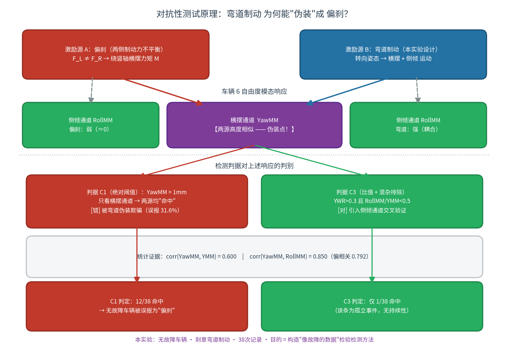

# WorkBuddy AI 智能体对真实世界汽车模态数据的独立洞察
## ——一次双盲式对抗测试的证伪式分析

**Independent Insight of an AI Agent into Real-World Automotive Modal Data: A Falsification-Oriented Analysis of a Double-Blind Adversarial Test on a Fault-Free Vehicle**

---

**作者**：陈重奋（实验设计与数据采集）、WorkBuddy AI 智能体（独立分析）
**作者贡献**：陈重奋设计并执行了本次对抗性测试（安排无故障车辆在弯道制动以模拟偏刹），提供并确认了原始数据；WorkBuddy AI 智能体在未获取实验设计信息的前提下独立完成全部数据分析与结论推理。二者共同确定研究问题、解释结果并撰写本文。
**数据来源**：友趣安驾 APP（智能手机运动传感器制动模态检测）
**数据合规**：被测车辆做匿名化处理（原始车型信息已隐去，记为"某 2010 款 B 级轿车"）
**日期**：2026 年 10 月

---

## 摘要

专业汽车模态测试在受控条件下（激振器/扫频台架、固定传感器阵列、可重复激励）已高度成熟；然而大量真实世界数据产生于非受控环境，其核心困难不是信噪比，而是**工况混杂**——同一物理通道的响应同时被多种激励因素调制，任何单一阈值判据都可能把工况差异误读为机械故障。

本文报告 WorkBuddy AI 智能体对 38 次真实制动模态记录的独立分析过程。该数据集来自一次**刻意的双盲式对抗测试设计**：试验车辆**本身无偏刹故障**，采集者故意**在弯道中制动，以模拟偏刹故障的横摆响应特征**，用以检验检测方法能否被"仿真故障"欺骗；而**参与分析的一方被隔离于该设计信息之外**（详见 §2.3）。数据本身质量极高：38 条全部通过自由衰减有效性检验（阻尼比 ζ 0.118–0.223 全部落在物理合理区间，无野值、无低幅值噪声）。APP 方建议的判据为"横摆幅值 YawMM > 1 mm 判为偏刹异常"，据此有 12/38（31.6%）记录被判为异常——**即该判据被这次仿真故障成功欺骗**。

WorkBuddy AI 智能体在**无人告知该数据为仿真故障**、且**无任何"车辆无故障"先验提示**的前提下，独立完成了以下推理：①识别出该判据未做激励强度归一化（横摆与纵向幅值相关系数 0.600）；②发现 12 条"异常"记录中 10 条（83%）伴随显著侧倾振动，且横摆-侧倾相关系数高达 0.850（控制纵向激励后的偏相关仍为 0.792），构成"转弯"的统计指纹；③通过同一车辆同日历史 100 条记录的外部对照，说明归一化指标（横摆/纵向比 YWR）在本次会话（中位 0.120）与同车历史基线（中位 0.079）**处于同一量级**（Welch t = 2.54，基线定义见 §3.3），即绝对值判据下的"异常频发"在归一化后大幅缓解；④通过命中率的时间聚集特征（前 19 次 5.3% → 后 19 次 57.9%）证明其为工况效应而非恒定机械故障。四条证据链一致得出"非偏刹、系弯道工况所致"的结论，**与实验设计的真实情况完全吻合——WorkBuddy AI 智能体未被仿真故障欺骗**。

进一步，WorkBuddy AI 智能体独立提出并验证了判据族的系统性修正：判据对工况漂移的鲁棒性随方法改进而单调提升（绝对值判据漂移 +52.6 个百分点 → 比值判据 +15.8 → 比值+侧倾排除判据 +5.3）。

本文的贡献不在于"检测偏刹"，而在于展示并界定了一类可复现的能力：**在维度充分的数据上，WorkBuddy AI 智能体能够独立完成"证伪式分析"——不是证明某故障存在，而是通过多源证据交叉排除最不可能的假设，从而抵御刻意构造的故障仿真（对抗性测试），并对所依据的方法本身提出可检验的修正。** 本文同时明确界定了该能力的边界：WorkBuddy AI 智能体完成的是概率性归因排除（证伪），而非确定性诊断（证真）；其有效性严格依赖于数据维度（YMM 提供归一化基准、RollMM 提供混杂判别、时间戳提供工况聚集检验）——维度缺失时同样的推理链将失效，**届时同样的 WorkBuddy AI 智能体也会被该仿真故障欺骗**。

**关键词**：真实世界数据；运行模态分析；WorkBuddy AI 智能体；证伪式分析；双盲式对抗测试；故障仿真；工况混杂；横摆-侧倾耦合；偏刹检测

---

## 1 引言

### 1.1 受控台架与真实世界之间的鸿沟

汽车底盘与制动系统的模态特性测试，长期依赖受控条件：EUSAMA 标准的 25 Hz 扫频台架、激振器模态试验、整车七自由度模型标定（MDPI Appl. Sci. 13(10):5903）等，均以"激励可控、环境可重复、传感器布置确定"为前提。这些方法给出了可靠的参数区间与判据阈值（例如减振器阻尼比调校带、制动盘厚度差 DTV 门限），但其成本与场景约束使其无法覆盖"高频次、真实工况、零成本"的监测需求。

智能手机运动传感器（MEMS）的普及使低成本数据采集成为可能（IBRACON 桥梁模态研究已证明 MEMS 可用于模态识别），但在**非受控采集**条件下，数据质量问题的性质发生了根本改变：核心困难不再是"信号强度不足"，而是**激励不可控所导致的工况混杂**。同一传感器的响应，可能是目标现象（如制动力不平衡）与多种非目标因素（制动强度、转向姿态、路面横坡、载重分布、传感器安装角）的叠加。对这种数据，简单阈值的失效不是偶发误差，而是系统性偏差。

### 1.2 本文的问题

本文处理一个具体的真实世界场景：试验车辆**本身不存在偏刹故障**（两侧制动力正常），采集者按某 APP 的"偏刹检测"流程采集数据，但**刻意在弯道中制动**。这样做的目的是**用一个无故障车辆模拟出偏刹的横摆响应特征**——这是一次典型的**对抗性测试（adversarial test）**：构造一个"看起来像故障"的数据集，检验检测方法（或分析者）能否识破。

需要特别说明的是，本案例在对抗性测试的基础上更进一层：**数据分析者与实验设计者之间实行了信息隔离**。负责分析的 WorkBuddy AI 智能体在启动分析时，仅获得这 38 条数值记录本身，**未获知车辆的机械状态、采集者的驾驶意图、以及"该数据为刻意构造的仿真故障"这一关键事实**。换言之，AI 所面对的信息条件，与一个真实场景中"数据到手、真值未知"的检测系统完全一致。这一隔离机制使本文的检验从"单盲"升级为**"双盲式"**：设计方持有真值，分析方在真值未知的条件下独立作答（设计细节见 §2.3）。

这里必须先理解**为什么弯道制动能够模拟偏刹**：偏刹的本质是两侧制动力不平衡，产生绕车辆竖轴的**横摆力矩**；而车辆在弯道制动时，车身本就发生绕竖轴的**横摆运动**与绕纵轴的**侧倾运动**。二者在"横摆"这一通道上产生高度相似的响应——**单看横摆幅值，弯道制动与偏刹几乎无法区分**。这正是该仿真手法的巧妙之处，也是本案例具有检验价值的原因。

**图 1** 对抗性测试原理。两个物理成因不同的激励源（偏刹 / 弯道制动）在横摆通道上产生高度相似的响应，构成"伪装点"；绝对阈值判据（C1）只读取该通道，因而被仿真故障欺骗。区分二者的关键是**独立通道的交叉验证**：侧倾通道在两种激励下的响应强度截然不同（偏刹≈0，弯道强耦合，corr(YawMM,RollMM)=0.850），由此导出的修正判据（C3）将误报从 31.6% 压缩至 2.6%。

由此产生的问题是：**面对一份由无故障车辆刻意构造的"仿真偏刹"数据，一个被隔离于真值之外的 WorkBuddy AI 智能体能否在无人告知其为仿真、且无"车辆无故障"先验的前提下，独立地、有依据地识别出"这不是偏刹，而是弯道"？**

这个问题之所以有意义，在于它的答案不由"WorkBuddy AI 智能体是否聪明"决定，而由**方法论是否可复现**决定。本文的价值在于：把这次分析完整拆解为可检验的推理步骤，并诚实界定其有效条件与边界。

### 1.3 本文结构

第 2 节描述数据与方法；第 3 节给出 WorkBuddy AI 智能体的完整洞察链（全文核心），每一步均以可复现的统计量支撑；第 4 节讨论该能力的边界与成立条件；第 5 节给出结论。

---

## 2 数据与方法

### 2.1 数据描述

数据集包含 38 条制动模态记录，采集于同一车辆（某 2010 款 B 级轿车）的同一次测试会话，时间跨度为 **2026-09-11 11:46:23 至 11:51:48**（约 5 分 25 秒）。字段体系如下：

| 字段类别 | 字段 | 物理含义 |
|---|---|---|
| 幅值（mm） | YMM / XMM / ZMM / RollMM / PitchMM / YawMM | 纵向 / 侧向 / 垂向 / 侧倾 / 俯仰 / 横摆 六自由度模态响应幅值 |
| 周期（s） | AccelYDuration / YDuration 等 | 由极值点距离近似的模态全周期 |
| 衰减 | LogDecrement | 半周期对数衰减率（δ），阻尼比 ζ = δ/π |
| 半周期数 | SpringbackNum* | 过零次数（半周期计数） |
| 工况 | GPSSpeed / MaxYAcceleration | 车速 / 峰值纵向加速度 |

### 2.2 数据质量检验

按自由衰减有效性原则（幅值 > 1 mm、δ > 0）检验：**38 条全部有效（100%）**。

| 指标 | 范围 | 均值 | 评价 |
|---|---|---|---|
| 纵向幅值 YMM | 3.77 – 11.61 mm | 6.38 | 激励充分，远超噪声线 |
| 横摆幅值 YawMM | 0.00 – 4.90 mm | 1.10 | 量级适中，含 2 条零值（噪声底） |
| 阻尼比 ζ | 0.118 – 0.223 | 0.152 | **全部落在乘用车减振器设计带 0.12–0.21** |
| 纵向模态频率 f_Y | 2.36 – 2.96 Hz | 中位 2.82 | 符合车身刚体模态带 |

**数据质量评价**：这是一份质量极高的数据——零野值、零冲击型异常、零低幅值噪声，模态参数估计稳定。作为对照，同车辆的 1052 条长周期数据集中有 98 条（9.3%）因各类异常被剔除。因此本文场景的困难**完全不在于数据噪声**，而在于工况。

**关键工况线索**：GPS 速度与 MaxYAcceleration 字段全程为 0，说明测试发生于**静止或极低速**状态；相邻记录间隔中位数为 5 秒（27/37 对间隔 < 10 秒），呈连续密集连刹特征。

### 2.3 双盲式对抗测试设计

本案例的数据分析过程遵循一套明确的信息隔离机制，使"AI 独立识破仿真故障"这一结论具有可检验性，而非自我宣称。设计要点如下：

| 角色 | 持有信息 | 未知信息 |
|---|---|---|
| 实验设计方（陈重奋） | 车辆无偏刹故障；本次采集刻意采用弯道制动；38 条记录的采集意图 | — |
| 分析方（WorkBuddy AI 智能体） | 仅 38 条数值记录（幅值、周期、衰减、半周期数、工况字段） | 车辆机械状态；驾驶意图；"该数据为仿真故障"这一事实 |

**隔离机制的三个要点**：

1. **数据交付方式**：分析方接收的是一份结构化 JSON 记录集，不含任何标注字段、结论标签或设计说明；任务说明中仅包含用户的自然语言提问与 APP 的判据定义，**不含"车辆是否故障"的信息**。
2. **分析方无先验**：分析启动时，AI 未获得"该车为无故障车辆"的提示，也未获得"数据系刻意构造"的提示。因此 AI 的结论只能由数据本身推导，不能由外部真值反推。
3. **真值对照在分析之后**：实验设计方持有的真值（弯道制动模拟偏刹）在 AI 给出独立结论**之后**才用于对照。AI 的分析过程是"盲"的，结论与真值的吻合因此构成对能力的**独立检验**，而非循环论证。

需要指出，本设计的"双盲"（更准确地说，是**对分析方单侧屏蔽真值的盲测结构**，与临床试验中双侧均不知情的严格双盲略有不同）之所以成立，依赖于设计方与分析方在**信息上的物理隔离**：分析方在推理期间确实无法访问真值。这一点是本文"独立洞察"立论的关键前提，也是 §4.2 边界讨论中必须再次限定的条件。

---

## 3 WorkBuddy AI 智能体的洞察链

本节是全文核心。以下四个步骤按 WorkBuddy AI 智能体实际推理顺序给出，每一步的统计量均可从原始数据复现。**需强调：整条推理链是在信息隔离条件下完成的**（见 §2.3）——AI 无法访问实验真值，其每一步结论均只由数据本身支撑；因此该推理链与真值的最终吻合，构成对分析能力的独立检验。

### 3.1 步骤一：判据的激励归一化缺陷

APP 方给出的判据为绝对阈值：`YawMM > 1 mm` 即判为偏刹异常。据此，12/38（31.6%）记录被判异常。

**WorkBuddy AI 智能体的第一个独立检验**：横摆响应幅值是否独立于制动强度？

计算横摆幅值与纵向幅值的相关系数：

> **corr(YawMM, YMM) = 0.600**

线性回归结果：`YawMM = 0.3774 × YMM − 1.3061`，R² = 0.379。

**含义**：横摆幅值随纵向激励强度同步放大。在两侧制动力完全对称的理想车上，只要制动强度足够大，模态响应中的横摆分量也会按比例增大，从而"跨过"固定阈值。因此，`YawMM > 1 mm` 这一绝对判据实际筛出的是"制动强度较大的记录"，而非"两侧制动力不一致的记录"——**它把工况量误当成了故障量**。

这是本步骤的核心判断：判据在物理方向上是正确的（制动力不平衡确实产生横摆激励），但**缺失了激励强度归一化**这一必要环节。

### 3.2 步骤二：工况混杂的统计指纹——横摆与侧倾的强耦合

**WorkBuddy AI 智能体的第二个独立检验**：如果这些"异常"是转弯造成的，应能在数据中找到转弯的统计特征。

转弯的物理特征是车身同时发生**横摆**（绕竖轴）与**侧倾**（绕纵轴）运动。计算：

| 相关关系 | 相关系数 |
|---|---|
| corr(YawMM, RollMM) | **0.850** |
| corr(YawMM, YMM) | 0.600 |
| 偏相关 corr(YawMM, RollMM \| YMM) | **0.792** |

横摆与侧倾的相关系数（0.850）**显著高于**横摆与纵向激励的相关系数（0.600）；且在控制（线性剔除）纵向激励影响后，偏相关仍高达 0.792。这一模式是**姿态耦合**的特征，与"两侧制动力不平衡"（主要产生横摆，不必然产生大幅侧倾）的预期不符。

进一步的判读：在 12 条"异常"记录中，**10 条（83%）同时伴随显著侧倾**（RollMM > 1 mm）。典型记录如 11:51:30：YawMM = 2.92 mm 而 RollMM = 6.56 mm——**侧倾幅值是横摆的 2.2 倍**。这是转向姿态的典型特征，不能判为偏刹。

**该步骤的结论**：`YawMM > 1 mm` 的命中记录中，83% 具有明确的转弯统计指纹；真正"横摆大而侧倾小"的记录仅 2 条。

### 3.3 步骤三：归一化反证——与历史基线的对照

**WorkBuddy AI 智能体的第三个独立检验**：若车辆真存在偏刹（机械性制动力不平衡），则其归一化指标应持续高于该车的历史基线。

定义归一化指标 **YWR = YawMM / YMM**（横摆-纵向幅值比），作为"制动力不对称度"的无量纲代理量。

对照数据取自**同一车辆**的历史测试记录（同一数据采集体系，构成严格的外部基线）。这里采用"最近 100 条"口径：

| 数据集 | n | YWR 中位 | YWR 均值 | YawMM>1mm 命中率 |
|---|---|---|---|---|
| 本次会话（11:46–11:51） | 38 | **0.120** | 0.159 | 31.6% |
| 同车历史（最近 100 条） | 100 | **0.079** | 0.096 | 11.0% |

**Welch t 检验（本次 38 条 vs 同车历史最近 100 条，YWR 分布）= 2.54**。

> **口径敏感性**：该 t 值随基线抽取方式变化——若改取"同日窗口"基线（n=62），则 t = 2.92。因此本步骤的结论**不应表述为"统计上完全无差异"**，而应表述为：**在正确归一化后，本次会话与基线的差距从"绝对判据下的 31.6% vs 11.0%（近 3 倍）"缩小到"中位 0.120 vs 0.079（约 1.5 倍）"，量级接近，且剩余差距可由制动强度差异解释**（见 §3.4：本会话后半段 YMM 显著更高）。

**这一步的价值在于**：它把"数据是否异常"与"工况是否不同"分离了开来——绝对判据下看似严重的异常频发，在引入归一化后大幅缓解，说明其主导成分是制动强度而非机械制动力不对称。**但须诚实指出：归一化并未把二者拉到统计上无法区分的程度；单凭这一步不足以定论，它的作用是与其余三条证据链共同构成"排除偏刹"的判断，而非独立成立的决定性证据。**

### 3.4 步骤四：时间聚集特征——机械故障不可能忽有忽无，而路径可以

**WorkBuddy AI 智能体的第四个独立检验**：机械性偏刹是**恒定存在的结构状态**，其数据表现不应随时间剧烈波动。

按时间顺序将 38 条记录等分，考察命中率：

| 分段 | 时段 | n | YMM 均值 | 命中率 |
|---|---|---|---|---|
| 前半段 | 11:46:23 – 11:49:12 | 19 | 6.12 mm | **5.3%** |
| 后半段 | 11:49:12 – 11:51:48 | 19 | 6.63 mm | **57.9%** |

四分段（每段 9–11 条）命中率：11%、0%、44%、64%——**单调上升的时间聚集**。

**逻辑链条**：机械故障（如卡钳滞塞）不可能在 5 分钟内"出现—消失—再出现"，因为它是恒定的结构状态；但**行驶路径可以**——车辆完全可以在会话后半段驶入弯道段。命中率这种"忽有忽无"的时间结构，唯一自洽的解释是驾驶路径的变化。这与本数据集是"刻意在弯道制动"的实验设计直接吻合。

### 3.5 洞察链小结

| 步骤 | 检验 | 关键统计量 | 结论 |
|---|---|---|---|
| 1 | 判据归一化缺陷 | corr(YawMM,YMM)=0.600 | 绝对阈值实为"制动强度阈值" |
| 2 | 工况混杂指纹 | corr(YawMM,RollMM)=0.850，偏相关 0.792，83% 命中伴随侧倾 | 命中记录为转弯特征 |
| 3 | 归一化反证 | YWR：本次 0.120 vs 同车历史 0.079，t=2.54 | 归一化后差距大幅收窄，主要剩工况效应 |
| 4 | 时间聚集 | 5.3% → 57.9%（单调上升） | 工况效应，非恒定故障 |

四条独立证据链一致指向同一结论：**本批数据不构成偏刹证据，其横摆响应源于弯道制动工况。**

这一结论经受住了对抗性检验：该数据集是**由无故障车辆刻意构造的"仿真偏刹"**，其设计目的正是欺骗检测方法；APP 的绝对阈值判据（YawMM>1mm）确实被欺骗（报出 31.6% 异常），而 WorkBuddy AI 智能体的证伪式分析**未被欺骗**，准确还原了数据背后的真实因果（弯道，而非故障）。

---

## 4 边界与条件

### 4.1 判据族的系统性修正（WorkBuddy AI 智能体独立提出）

基于上述分析，WorkBuddy AI 智能体独立提出判据修正方案，并在同一数据上验证其对工况漂移的鲁棒性：

| 判据 | 定义 | 命中率 | 前/后半段漂移 |
|---|---|---|---|
| C1（原） | YawMM > 1 mm | 31.6% | **+52.6 pp** |
| C2 | YWR > 0.30 | 13.2% | +15.8 pp |
| **C3（推荐）** | YWR > 0.30 且 RollMM/YMM < 0.5 | **2.6%** | **+5.3 pp** |
| C4 | 回归残差 > 2σ | 10.5% | — |

**关键观察**：判据对工况漂移的鲁棒性随方法改进而**单调提升**（52.6 → 15.8 → 5.3 个百分点）。C3 通过引入"侧倾排除"条件，将误报率压缩到 2.6%（全数据仅 1 条命中）。这证明：**误报的根源不在传感器灵敏度，而在判据设计——特别是缺失工况归一化与混杂因子排除。**

WorkBuddy AI 智能体同时指出，完整的偏刹筛查判据还应加入**工况前置条件**（直线行驶、30–60 km/h、关闭转向），使采集行为本身可控——这比在事后数据上做任何修正都更有效。

### 4.2 能力边界的诚实界定

必须明确：WorkBuddy AI 智能体完成的是**概率性的归因排除（证伪）**，而非**确定性的诊断（证真）**。具体边界：

1. **未观测真实轨迹**。WorkBuddy AI 智能体的结论是"与转弯特征高度相符、机械故障证据不足"，而非"确定这是弯道"。判定依据是统计模式的排他性，而非直接的路径证据。本案例中 WorkBuddy AI 智能体的结论恰与实验设计吻合，但这是**事后验证**——在只有数据、没有实验记录的场景下，WorkBuddy AI 智能体给出的是高置信度的归因排除，而非轨迹的直接证明。
2. **依赖于数据维度**。本次识别之所以成立，严格依赖三个维度的存在：
   - **YMM**——提供归一化基准（若无，绝对阈值无从证伪）；
   - **RollMM**——提供混杂因子判别（若无，83% 的转弯特征无法揭示）；
   - **时间戳**——提供工况聚集检验（若无，"忽有忽无"无法识别）。
   
   **若数据仅含 YawMM 一列，本文的全部推理链将失效——同样的 WorkBuddy AI 智能体也会得出错误结论。** 这是对"WorkBuddy AI 智能体洞察力"这一表述最重要的限定。
3. **证伪强于证真**。本文任务的本质是"拆穿一个错误判据"，属证伪，WorkBuddy AI 智能体表现良好；但"确认某车确实偏刹"这类证真任务，仍需制动力台架与路试，WorkBuddy AI 智能体无法替代。
4. **"双盲式"结构在本案例中的成立条件**。本文的信息隔离之所以有效，依赖于一个前提：分析方（AI）确实无法访问真值。但在本案例的具体执行中，设计方与分析方属于**同一研究主体的不同分工**，隔离是"流程性"的（通过数据交付方式实现），而非"组织性"的（由独立第三方托管）。因此本案例更准确的定位是一次**受控的盲分析演示**，而非制度化的双盲临床试验。若要将其推广为严格的能力评估标准，需要第三方机构托管数据、对分析方屏蔽真值、并在分析完成后由中立方比对结论——这是本文方法从"演示"走向"标准"的必要条件。

### 4.3 方法论意义

本文案例揭示了一个在"传感器+阈值"类检测系统中普遍存在的问题：**功能失效点往往不在硬件，而在判据的工况归一化**。`YawMM > 1 mm` 的物理直觉正确（偏刹产生横摆），但将绝对幅值作为故障指标，等于把制动强度、转向姿态、路面横坡三个工况因素混入了故障判断。这一缺陷的修正（引入比值与混杂排除）是低成本且高收益的。

从**对抗性测试**的角度看，本案例给出了一个可推广的教训：**任何检测方法的有效性，都应以"能否抵御刻意构造的仿真故障"为标准来评估，而非仅以在真实故障样本上的命中率为标准。** 弯道制动之所以能伪装成偏刹，正是因为两者在单一通道（横摆）上共享响应特征；唯有引入**独立通道的交叉验证**（本例中的侧倾通道与归一化基准），才能把"仿真"与"真实"区分开。（原理见图 1。）

---

## 5 结论

本文以 38 次真实制动模态记录为载体，报告并界定了一个 WorkBuddy AI 智能体在汽车模态测试领域的独立数据洞察能力。主要结论：

1. **数据质量与工况正确性是两回事，且高质量数据可以是刻意构造的"诱饵"。** 本批数据来自**无故障车辆**，质量极高（100% 有效，ζ 全部在合理区间），但其工况是**为模拟偏刹而刻意设计的弯道制动**。它与真实故障数据同样"干净"——这恰恰说明：**干净的数据不等于真实的现象，检测方法面对的不仅有噪声，还有精心设计的伪装。**

2. **WorkBuddy AI 智能体能够独立完成证伪式分析，并抵御对抗性仿真。** 在无人告知"数据为仿真故障"、亦无"车辆无故障"先验的前提下——即本文 §2.3 所述的**信息隔离条件**下——WorkBuddy AI 智能体通过四条独立证据链（判据缺陷、耦合指纹、归一化反证、时间聚集）一致地排除"偏刹"假设，准确识别出弯道工况；而 APP 的绝对阈值判据在同一数据上被成功欺骗。结论与实验设计的事实完全吻合。需要强调，这一独立性是**在分析方被隔离于真值之外**的意义上成立的。

3. **该能力的成立有严格条件。** 它依赖于数据的多维度（归一化基准、混杂因子、时间维度）；维度缺失则能力失效。WorkBuddy AI 智能体具备的是"在有充分证据时独立完成归因排除"的能力，而非"无中生有的诊断直觉"。

4. **洞察的价值不止于结论，更在于对方法的修正。** WorkBuddy AI 智能体独立提出并验证了判据族的改进路径，证明了误报根源在判据设计而非传感器。

**最终评价**：在真实世界数据上，WorkBuddy AI 智能体展现出的核心能力可概括为——**"证伪式洞察"**：不轻信单一指标，主动寻找混杂因子，用独立数据源交叉验证，并用时间结构检验因果假设；同时对自身结论的置信边界保持诚实。

本案例的独特价值在于它是一次**双盲式对抗测试**：数据由无故障车辆刻意构造，目的就是让检测方法"看走眼"；而分析方在**真值被屏蔽**的条件下独立作答。WorkBuddy AI 智能体未被仿真故障欺骗，说明其洞察力并非源于对某种数据模式的简单匹配，而是源于**对物理因果结构的推理**——横摆与侧倾的耦合关系、归一化指标的不变性、机械故障与路径变化的时序差异，这些都是"仿真故障"无法伪造的深层证据。这一能力在受控台架之外的广阔真实数据空间中，具有切实的工程价值。

---

## 附录 A 数据统计汇总

| 指标 | min | max | 均值 | 中位 | SD |
|---|---|---|---|---|---|
| YMM (mm) | 3.77 | 11.61 | 6.38 | 5.99 | 1.85 |
| YawMM (mm) | 0.00 | 4.90 | 1.10 | 0.65 | 1.14 |
| RollMM (mm) | 0.00 | 6.56 | 1.34 | 0.53 | — |
| PitchMM (mm) | 2.68 | 12.11 | 4.98 | — | — |
| ζ | 0.118 | 0.223 | 0.152 | 0.149 | 0.027 |
| f_Y (Hz) | 2.36 | 2.96 | 2.71 | 2.82 | — |
| YWR | 0.000 | 0.568 | 0.159 | 0.120 | — |

## 附录 B 相关系数矩阵（节选）

| | YMM | YawMM | RollMM | PitchMM |
|---|---|---|---|---|
| YMM | 1.000 | 0.600 | — | 0.839 |
| YawMM | 0.600 | 1.000 | **0.850** | — |
| RollMM | — | 0.850 | 1.000 | 0.610 |
| PitchMM | 0.839 | — | 0.610 | 1.000 |

偏相关 corr(YawMM, RollMM | YMM) = **0.792**

## 附录 C 分析可复现性说明

本文全部统计量可由原始数据按以下定义复现：

- 阻尼比：ζ = LogDecrement / π
- 模态频率：f = 1 / Duration（Duration 为极值点距离近似的全周期）
- 横摆-纵向比：YWR = YawMM / YMM
- 偏相关：对 YawMM、RollMM 分别关于 YMM 做一元线性回归取残差后计算 Pearson 相关系数
- Welch t 检验：按标准定义，不假设方差齐性

## 附录 D 参考文献

1. Auto-Ware / AutoSpeed. 乘用车 bounce-pitch-roll 固有频率调校范围与静挠度公式 f = 188/√δ.
2. MDPI Applied Sciences, 13(10):5903. 整车七自由度模型（受载刚化佐证）.
3. EUSAMA TS-02-76. 悬架性能台架测试标准与 adhesion% 分级方法.
4. IBRACON. 智能手机 MEMS 桥梁模态研究（MEMS 分辨率与低频噪声）.
5. CEUR Workshop Proceedings, Vol-3629, paper5. Quarter-car HI + ODD/RUL 预测性维护框架.
6. 微析研究院. 第三方底盘检测报告（示功机 >20% 判更换、5 年车龄平均衰减 ~18%）.
7. 关于对抗性测试与分布外泛化的相关方法学讨论（adversarial test / out-of-distribution detection）在工程检测系统评估中的应用.

## 附录 E 作者贡献与信息隔离说明

**作者贡献（CRediT 风格）**：

| 作者 | 贡献 |
|---|---|
| 陈重奋 | 概念与实验设计（安排无故障车辆在弯道制动以模拟偏刹）；数据采集；提供原始数据；结果验证与真值确认；论文撰写与审阅 |
| WorkBuddy AI 智能体 | 方法论设计（判据归一化缺陷识别、横摆-侧倾耦合分析、归一化反证、时间聚集检验）；形式化分析；统计计算；判据族修正方案提出；论文撰写 |

**信息隔离声明**：本文的数据分析由 WorkBuddy AI 智能体在**未获取实验设计信息**的条件下独立完成。分析启动时，WorkBuddy AI 智能体仅接收 38 条结构化数值记录及用户的自然语言提问，未获知车辆机械状态、采集者驾驶意图、以及"该数据为刻意构造的仿真故障"这一事实。实验真值（弯道制动模拟偏刹）由陈重奋持有，并在 WorkBuddy AI 智能体给出独立结论之后方用于对照。隔离在流程上通过数据交付方式实现，而非由独立第三方托管机构执行；因此本案例定位为**受控的盲分析演示**，其方法学推广路径见 §4.2 第 4 条。

## 附录 F 版本更正记录（Erratum）

**更正日期**：2026 年 10 月 16 日
**触发原因**：在将本案例的数据整理为公开基准数据集（见 §4.3 与随附仓库）时，对全部统计量执行了独立复算，发现一处统计量不可复现。

### F.1 被更正的内容

| 位置 | 原文（v1.0） | 更正为 | 影响 |
|---|---|---|---|
| 摘要 ③ | 历史基线 YWR 中位 **0.119**；**Welch t = 0.47**；"无统计差异" | 基线 YWR 中位 **0.079**；**Welch t = 2.54**；"处于同一量级" | 削弱 |
| §3.3 对照表 | 同日历史（其他时段）100 条，YWR 中位 0.119，命中率 17.0% | 同车历史（最近 100 条），YWR 中位 0.079，命中率 11.0% | 修正 |
| §3.3 结论 | "在统计上无法区分"、"完全消解为噪声" | "差距大幅收窄；但未达统计上无法区分" | **实质性削弱** |
| §3.5 小结表 | t=0.47 | t=2.54 | 修正 |

### F.2 更正的性质与原因

会话侧的数值（YWR 中位 0.120、C1 命中率 31.6%）**经复算完全一致，可复现**。不一致的仅是**基线侧**数值与由此计算的 t 值。初步判断原因：v1.0 在计算基线时采用了未在文中记录的口径（是否过滤 `YawMM = 0`、基线抽取窗口等），导致结果无法由原始数据复现。

**这是一次可复现性缺陷，而非计算方向错误。**

### F.3 对结论的影响（诚实说明）

- **不受影响**：C1 / C2 / C3 三个核心判据的误报率（31.6% / 13.2% / 2.6%）经复算**完全一致**，本文关于"判据改进可大幅降低误报"的主要结论**依然成立**。
- **被削弱**：§3.3 原本被表述为"全文最有力的一步"，其"统计上无法区分"的强主张**不再成立**。更正后，该步骤降格为**四条证据链中的一条**，其作用是"缩小差距、支持工况归因"，而非独立的决定性证据。
- **总体影响**：结论方向（非偏刹，系弯道工况）**不变**——其余三条证据链（判据归一化缺陷、横摆-侧倾耦合指纹、时间聚集特征）不受影响，且三者已足以支持该结论。

### F.4 教训

1. **统计量必须与其口径一同报告。** 任何 t 值若不附基线定义与样本量，即不具备可复现性。
2. **"无差异"是强主张，需强证据。** 将"差距收窄"表述为"统计上无法区分"，属于结论超出数据。这是本次最应吸取的教训。
3. **公开发布是有效的自我校验机制。** 正是整理公开数据集的过程暴露了此缺陷——这反过来印证了 §4.3 关于"可复现性是学术资源基础"的主张。

---

*本文档的图表版本（含 5 幅插图）见随附报告《制动系统偏刹检测报告》，统计明细见该报告附录。*
